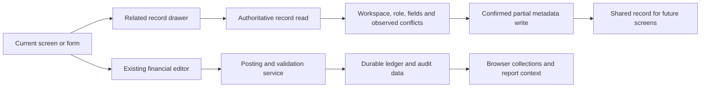

# Developer workflow guide

This guide follows the running code, not the feature names in a menu. Read `AGENTS.md` and `docs/COORDINATION.md` first. Ownership there can change while you work; check the current remote before selecting files and again before pushing. This guide does not grant access to another agent's reserved files.

## Trace a feature before changing it

For any screen, identify these six points and put them in the task notes:

1. Entry: registration in `src/config/registry.tsx`, parent props, URL/hash and workspace selection.
2. Inputs: store selectors, lazy collection requests, filter state and whether the loaded collection is complete.
3. Computation: the shared pure helper that owns the number; units, currency, date and account roles.
4. Action: the hook/route responsible for saving; required role, workspace, confirmation and pending state.
5. Persistence: database collection and migration/policy; atomic writes, retries, rollback and idempotency.
6. Evidence: existing tests plus a meaningful test at the boundary affected by the change.

A visible button, registry entry, successful local state update or toast is not evidence of a saved operation. Follow the promise through the server/database path. Reopen after saving or fetch the saved record in a test. A guest-mode browser test proves browser behavior, not authenticated production integration.

## Documents and the ledger

`src/hooks/useEntityOperations.ts` dispatches invoices, bills, credit notes and vendor credits to `LedgerPostService`. Its public facade in `src/services/LedgerPostService.ts` delegates to `src/services/ledgerPost/`. Documents and entries are sent together through the transaction API; do not create a parallel direct write of financial entries from a new component.

When updating a document, retain the complete saved record. `savedRecord()` reads from the database when the lazy list has not loaded. Treat a missing UI list as unknown, not as an empty document. Keep stable IDs/reference metadata so related records and reversal logic can find each other.

Resolve chart-account roles with `resolveAccountRole` and the shared account helpers. Refuse a posting with a useful error if its required account is absent; do not pick the first account. Preserve currency, exchange rate, document references, tax breakdown, dimensions and item IDs. Use existing document arithmetic in `src/lib/documentMath.ts` and posting logic; do not recompute invoice totals in JSX.

Verify create, update and failure behavior with a balanced hand-calculated fixture. Include a locked period, a viewer request, a cross-workspace record, a repeated request and a failed server response when those boundaries are affected. Editing a posted document must preserve its audit/reversal contract rather than silently replacing ledger history.

## Amounts, currency and status

- `totalAmountCents` is an absolute transaction amount. Its sign does not describe income or expense. Direction comes from signed lines and account roles.
- Use `isPostable` for actual financial reports; drafts, voids and simulation records have distinct status contracts. Do not invent an abbreviated status check in a new reporting route.
- Use `lineAmount(line, transaction)` and existing base-currency helpers where conversion is required. Do not add raw mixed-currency line amounts.
- Display money with `formatCurrency` and the appropriate document/workspace currency. Currency fraction digits vary. Do not divide an amount by 100 inside a view.
- CSV must use `downloadCsv`, `csvMoney` and the shared writer. It quotes cells, protects spreadsheet formulas and preserves UTF-8. The existing CSV decimal helper currently follows a two-decimal contract: verify zero-/three-decimal currencies before extending exports; do not silently change that global contract.
- Keep precise arithmetic and validation in the pure/shared domain functions. Monetary regression expectations are independent hand calculations; do not change established expected numbers to make an implementation pass.

## Reporting and incomplete data

The browser ledger is a workspace-scoped cache, not proof that every row in the database has loaded. `src/lib/ledgerCollections.ts` defines loading/cap behavior; a consumer of a lazy collection must call `useLedgerCollections`. Honor collection truncation and report-authoritative flags.

`src/server/routes/reportRoutes.ts` obtains an authorized workspace's complete report context and calls `src/server/reports/computeReports.ts`. P&L is activity between inclusive dates. Balance sheet is a snapshot through the end date, including prior activity and opening balances. Splitting a balance sheet into months must not discard activity before each month's start.

For period columns, use `src/lib/reportColumns.ts`, not new copies of the statement formulas. Calendar month bounds and fiscal quarter bounds are clipped to the selected range. Comparison periods belong to their own selected range. Test an April-start fiscal year, leap February, partial periods, previous zero/negative values, and account rows present only in another period.

Server response ownership must include workspace, dates, kind and the source data generation. An old response must not overwrite a new selection. Cancel obsolete effects logically even if the shared fetch API does not expose `AbortSignal`. Mark local fallbacks and prevent exporting truncated data as a complete report. Sort/export/drill-down must use the same period and figures shown in the table.

## Banking and matching

Trace imports through format parsing, source fingerprinting, mapping/validation and saved bank lines. Do not alter existing import fingerprints just to improve search. Distinguish potential duplicates from proven duplicates.

Matching is suggestion generation; durable reconciliation is the server endpoint's job. Check the full candidate set, one-to-one assignments and signed/base-currency amounts. Use the existing global matching implementation, not independent greedy guesses. A match proposal should not become a posted transaction without the intended user action. Preserve matched history and its reversal/unmatch boundaries.

Test repeated imports, ambiguous candidates, a partial/multi-entry match, unmatched data, same amounts with different merchants, and workspace boundaries. See `global-match.test.ts`, `reconcile-endpoint.test.ts`, `banking.test.ts`, `ofx.test.ts` and browser banking suites.

## Inventory

Quantities are not editable financial cache values. `src/server/services/cogsStockService.ts` applies invoice-linked COGS stock movement and reversal in the same database transaction as the ledger entries. `stockAdjustmentService.ts` owns adjustments/counts. Preserve item IDs, quantity precision, quantity delta, item workspace and reversal-once rules.

The quantity-protection migration prevents direct browser writes. Do not work around it by updating the item from a modal. A successful adjustment needs both stock and ledger evidence; a failed one needs neither change. Selling below zero follows one workspace rule (W-06): by default an invoice is recorded with a warning; with the owner's "Refuse sales beyond stock" (`refuseNegativeStock`, server-written) `prepareStockMoves` refuses it with nothing written. Adjustments never go below zero, and the manual COGS route always refuses it. A new stock-decreasing path must go through `prepareStockMoves` to keep the rule. Every quantity change also writes its record to the stock-moves ledger (W-02, `writeStockMoves` in `src/server/services/stockMoveService.ts`) in the same database transaction, with the quantity before and after; a new path that changes `quantityAtHand` without it makes the nightly "stock-history" check report the item. Missing/deleted items have explicit warning behavior. When stock leaves (BF-08 step 2) is the workspace's `goodsLeaveWith`: with the invoice (default; `planInvoiceCogs`) or with a delivery from the order (`deliveryService.ts`, 'delivery-cogs-auto' entries with ids from the delivery id, so retries change nothing). In delivery mode `prepareStockMoves` refuses a new invoice cost entry, and `stockMovesReady` lets every path skip the history while the stockMoves migration is not applied.

Use `stock-adjustments.test.ts`, `stock-dialogs.test.tsx`, invoice COGS tests and RLS checks. Include duplicate reversal, foreign-workspace item, invalid quantity and server failure where applicable.

## Tax, payments and credit allocation

Use `taxCodes.ts` and `documentMath.ts` for tax codes, components, compounding, inclusive/exclusive prices and document totals. Tax return services own return construction/filed state. A displayed tax summary is not a statutory filing integration. Preserve archived return/audit behavior and locked periods.

Payments, credits and deposits reduce what is still due, not merely the original invoice total. Use `calculateAmountDue`, existing allocation helpers and the server payment/credit/deposit services. Keep invoice currency separate from report base currency. A customer that also appears as a vendor must not have unrelated debts offset by a label match.

Test partial payments, payment before/after report date, credit allocation, over-allocation refusal, idempotent retry, FX rounding and atomic server failure. Relevant evidence includes `payment-atomicity.test.ts`, `allocation.test.ts`, `credits.test.ts`, `deposits.test.ts`, `fx-posting.test.ts`, `aging.test.ts`, `statement-credits.test.ts` and route tests.

## Search, labels and mixed Hebrew data

Keep menus/options in English for the owner's requested scope. Support Hebrew and mixed-script data throughout parsing, labels, items, references, dimensions, imports and export. Treat the exact displayed/stored text as data.

Use `normalizeSearchText` for comparison-only folding (Unicode NFC, Hebrew marks and direction controls). Never apply it to stable IDs, persisted text or import fingerprints. Do not use ASCII-only `\w`, `[a-z]` or punctuation replacement as a record identity. Quoted directives and nested dimension values need explicit parsing and resolution.

Test distinct Hebrew-only names, mixed Hebrew/Latin labels, niqqud, punctuation, quoted values, nested dimensions, negative directives and CSV round trips. Also trace learned-pattern persistence: good Unicode matching in a pure algorithm does not prove that the save hook preserves distinct identities. `useEntityOperations.recordLearnedPattern` currently has an ASCII-only key transform; see the review findings before claiming complete coverage.

## Pure algorithms and analytical tools

Algorithms accept their inputs and ledger/account context; they must not fetch, read stores or post changes from `compute()`. Register them through `src/lib/algorithms/index.ts`; the sandbox supplies their control UI. Keep output models typed and document units, assumptions and insufficient-data behavior.

Inspect the actual formula and its input source before describing a tool. Monte Carlo projections, anomaly scores, churn models and similarity scores are estimates, not verified balances or proof of fraud. Distinguish statistical simulations from operational integrations. Keep random generators' shared state/seed contract intact during file splits. A stochastic test should check invariants or use a deterministic seed rather than expect an unstable exact output.

## UI, navigation and accessibility

Use registered views and existing route/hash helpers. `openRecord` records a typed reference and selects its screen; a tab switch alone may not open the record. Preserve search/filter URL state and selected dates. Treat user/workspace changes as selection changes, including preferences and recent records.

Use native buttons for commands; separate sorting from filter buttons; labels need per-instance IDs; dialog overlays use `useDialog` for naming/focus/Escape/focus restoration. Never invoke save actions from disabled role-gated children. Async actions must disable repeat activation until the existing promise resolves. Disabling the focused field or Save button can move native focus to body: keep focus in the active dialog while pending and restore the initiating control on confirmation/refusal without stealing focus from a newer dialog or workspace. Verify Escape after saving, not only immediately after opening.

Virtualized list headers and cells must use the same visible columns, widths and order. Test actual Chromium alignment, scrolling and persistence after remount; jsdom has no layout. Keep phone touch targets at least 44 px, including checkbox labels, icon buttons and small filter chips, without obscuring rows or changing document arithmetic.

## Server and database work

Always check the live coordination ownership table before editing server or database code. A route needs authentication, membership, write role, parsed inputs and appropriate audit behavior; hiding a button is not authorization. A cached response also needs a defined membership-revocation/freshness policy.

Data is in workspace-scoped top-level Supabase/Postgres collections behind the Firestore-style adapters. A new collection needs a migration, `lf_rules` entry, policies, lazy-loading specification where applicable and RLS evidence. Never reuse a nested Firestore-style path that the adapter does not support. Server transactions must keep reads/writes/locking in the supported adapter order.

Apply new migrations to an existing test database deliberately; the whole setup script is not a general idempotent migration runner. Do not use production data for fixtures, print tokens or invent environment credentials. Mail, Plaid, Stripe and AI provider tests distinguish mocked contracts from configured external-service success.

## Verification and collaboration

For each task/commit, run the current required fast checks: type check, `npm test`, `npm run lint:eslint`, `npm run build`. Run browser checks around every five changes and before a review branch is final. Every approximately five commits, also run database/RLS, coverage, and unit tests under Pacific/Auckland and America/Los_Angeles as the current coordination requires. GitHub CI now runs weekly or manually, so local verification is necessary before pushing. Do not raise warning caps, coverage gates or quality baselines to get a green result.

Keep test source input and expected money values unchanged during refactors. For rendering splits, compare executable declarations/JSX or emitted output; for behavior changes, add boundary tests. Run Chromium without concurrent heavy CPU tasks and without source edits that trigger hot reload.

Fetch current main, inspect Claude's new messages/reservations and integrate through a normal merge. Preserve both agents' independent tests and improvements, resolve conflicting semantics explicitly, rerun the relevant combined checks and push normally. Never reset/force-push away another agent's changes. A branch push is not a merged PR or a production deployment; report the actual verified status.

## Editing related records without leaving a form

The owner prefers a side drawer. A selector for a customer, vendor, item, project or other related record should offer an explicit Edit details action beside the selection; add Create in context when the existing creation service supports it. Mount the drawer alongside the parent form. Keep its draft, scroll position and selected line intact. Closing the drawer must return focus to the triggering selector/button; Escape closes only the top drawer. Current invoice/bill dialogs use layer 600; the global related-record launcher uses 650 and its drawer 700 (backdrop 699), so the drawer actually remains reachable above a document form. Verify stacking in Chromium rather than assuming a named dialog is visible. Saving an address should update the shared record, not only a one-time copy in the current invoice.

Use a narrow, typed field allowlist for ordinary metadata. Never generate an arbitrary JSON editor for financial documents or write amounts, allocations, balances, stock quantities, account roles, period locks or posting status from a generic drawer. Those changes must invoke the existing financial editor/service and retain its validation. Fetch the latest record when a collection is absent or truncated; verify workspace, current membership/role and selected record after every asynchronous read. Save only changed fields, and warn on observed conflicting edits. Disable repeated saves, show actual failures and retain the draft until success is confirmed. Do not interpret a helper that catches an error and returns void as a successful save.

Switching account/workspace must clear drawer selection and drafts immediately. A request started in one workspace may not populate or submit into another. Test Hebrew addresses, mixed item names, multiline text, permission failure, stale records, rejected saves, nested-dialog Escape and retention of the parent document draft.

## Pinned pages and direct access

Page pins are preferences, never authority to access a record. Current main stores device-local page/subview references in useUIStore, with global Header pin control and PinnedPagesBar and Alt+P/Alt+1–9. Those files are reserved to Claude; use them rather than building a competing pin store. User/workspace scoping and date/filter capture are follow-up improvements, not current guarantees. Persist validated internal page references and report/settings subviews; avoid storing tokens, financial rows or arbitrary external URLs. Use existing navigation and record-opening helpers. Keep the pinned buttons available after navigating elsewhere, with an obvious unpin action and a compact phone layout. Document the actual shortcuts in the question-mark overlay. A navigation shortcut must not unexpectedly interrupt typing in a draft or bypass a dialog's focus boundary.

## Algorithm explanations and typed values

Every new analytical tool needs a readable account of its purpose, input data and scope, units, each parameter, assumptions, interpretation of results, a small example and insufficient-data/limitation behavior. Trace the implementation before writing help; do not repeat exaggerated registry marketing. For example, Monte Carlo uses the selected simulation count multiplied by 100, not always 10,000, and requires five distinct cash-movement days. Show an incomplete-data notice if the browser cache is truncated. Model output remains a scenario, not an automatic posting instruction.

Provide typed numeric fields alongside sliders. Keep an editable draft while the user types; commit a valid finite value on Enter or blur. Respect declared range and step, announce invalid input and retain the previous calculation on refusal. Do not clamp each keystroke or silently replace a blank with zero. Reset and slider changes must keep typed controls synchronized. Test boundaries, empty/invalid values, keyboard entry and unchanged calculation outputs for identical valid parameters.

## Trace examples for reviewing a change

| Trigger | Trace to inspect | What establishes the behavior |
|---|---|---|
| Correct a vendor address while entering a bill | RelatedRecordEditButton or contextual launcher → record-details drawer → authoritative metadata read → field allowlist/role/workspace checks → confirmed partial write | The shared vendor address persists; the parent bill number, selected vendor and line draft stay intact; a refused write leaves the drawer draft visible |
| Change a transaction's displayed amount | Existing transaction editor/action → current posting/validation route, not the generic drawer | Balanced line generation, period/role validation and server refusal; two-line behavior and source-document restrictions remain unchanged |
| Compare fiscal-quarter statements | Reports page date contract → reportColumns periods → existing pure statement function per period → StatementColumns formatting/CSV | Independently checked fiscal/leap boundaries, closing history retained, zero denominators handled, old workspace responses refused |
| Enter a new analytical parameter | NumericAlgorithmInput draft → declared parameter validation → existing algorithm context/compute → metrics/table/help | Typing does not clamp intermediate digits, invalid input leaves the previous result unchanged, and the same valid input gives the same deterministic calculation |
| Navigate to a pinned page | Existing global Header pin control and PinnedPagesBar → useUIStore.goToPage → registered page/subview | A pin remains reachable from another page; Alt+P/Alt+1–9 and phone targets work. Current implementation does not promise stored date/filter context |
| Edit an estimate reference on the list | Shared InlineEdit → confirmed scoped draft-only metadata update → latest record status guard | Viewers and non-drafts see text; an estimate converted before saving cannot be treated as an editable draft; no amount or ledger mutation is made |

The read/write conflict check detects changes observed before a save. It is not an atomic database compare-and-swap guarantee; new financial concurrency requirements must use an appropriate server transaction/version contract in the owning lane. Do not describe a browser read followed by an update as atomic.

## Existing inline field recipe

C-15 uses `RecordInlineField` with `inlineRecordFields` and the named database adapter. Choose a field from its allowlist, supply the rendered previous value, and await the confirmed write. The helper checks current role/workspace, authoritative record ownership, observed field conflicts, draft-only estimate status, text/date/email validation and planning-amount bounds. It never patches salary, tax components or posted values. The wrapper updates only the changed cache field, retains a retry value when the reserved shared InlineEdit closes on refusal, and refuses overlapping writes. Dimensions use composite document IDs and preserve prior labels as aliases; axis saves merge fresh workspace configuration and retain unfinished local node drafts. Project renames share a guard against observed legacy name links and unloaded, failed or incomplete history. These browser checks do not provide atomic server compare-and-swap; financial/reference migrations require the owning lane.

After a confirmed partial detail save, refresh both the baseline and displayed draft from the returned record. Otherwise an unchanged field refreshed by another editor can become an unintended change on the next save. Failed saves retain the draft.

## Dashboard reporting contracts

Overview enters through Dashboard → DashboardWidgets → dashboardOverview. KPI money comes from the existing computeProfitAndLoss/computeBalanceSheet functions, and aging from computePartyAging; do not add an independent posting/FX formula. Period income/costs differ from end-date asset/liability/cash snapshots. Twelve sparkline samples are calendar months ending at the selected end date; the final sample may be partial. The monthly tables are the accessible numerical counterpart. Opening balances and postable filtering retain the existing statement contract.

Dashboard receivables/payables use current unpaid amounts aged at the selected end date and exclude documents dated later; they do not rewind payments to reconstruct historical outstanding balances. Keep that limit visible. Missing party references remain visible by ID instead of dropping their balances. Capped/failed/loading collections require visible status; these local widgets do not establish full-history report completeness.

Report drill-through encodes validated exact start/end dates in reportPermalink. Reports shows the custom range, passes it to its existing report views and clears it when a preset changes. Personal widget preferences contain only validated widget IDs/order/visibility and are scoped by user/workspace; workspace changes remount state. Forecast scenario rows remain a separate preview and never affect posted KPIs.

BankFeedHealth reads the existing authorized token-free banks GET, cancels obsolete responses, refuses malformed/error responses, and offers the existing reconnect flow only to writers. Active connection status is not fresh-sync evidence. Until the server supplies a persisted successful-sync timestamp, show its absence. Refreshing status must not secretly run a financial sync.

## Shared financial charts

ChartFrame supplies chart/table state, native pressed legend buttons, typed money/day/number table columns and a keyboard-accessible date brush. FinancialChartPanels retains the four existing computeChartsData datasets. ChartExploration uses the existing statement and FX helpers: paid invoices need a valid recorded settlement date (not an inferred/weighted cash receipt), and expense hierarchy keeps stable account IDs and finite parent paths. Signed net values remain in tables; area diagrams draw positive net amounts only, with that limitation visible. Declare units before adopting the wrapper in algorithm charts; algorithm outputs may be dollars, ratios or counts rather than integer minor units. The current migration covers the financial chart family, not every unrelated visualization.

## Screen help contract

Register each screen with its actual purpose, available actions and relevant limits in `src/config/screenHelp.ts`. The registry attaches a required `help` field to sidebar screens, reports, settings, intelligence sections and analytical lenses. Non-sidebar routes also belong in `SCREEN_TABS_REGISTRY`; the coverage test fails when a route has no description. New registered entries need two to four plain sentences rather than a generic placeholder.

`ScreenHelpHeader` resolves the current report or settings section through existing navigation state. Its `useDialog` overlay keeps the parent screen mounted, restores focus and resets when the context changes. Do not make viewing help reset a form or navigate to another page. Help → All screens uses normalized English/Hebrew search while retaining English labels and original stored text. Help is documentation, so describe estimates, incomplete browser history and provider prerequisites accurately.

## Scenario calculation contracts

C-21 adds seven registry algorithms in separate `src/lib/algorithms/` modules. Manual depreciation, pricing, allocation and variance previews use typed scalar inputs, never mutate records and declare an empty `requires` list. Seasonal budgets use supplied posted expense/COGS lines with the shared `lineAmount` FX contract; customer cohorts use supplied issued invoice history, exclude opening-balance documents and preserve stable customer IDs. Neither establishes complete history when browser collections are capped.

Scenario money remains integer minor units. `previewMath` uses BigInt intermediates, rejects unsafe results, rounds nonnegative ratios half up and allocates floor shares with the remainder on the last positive-weight part. Production depreciation subtracts rounded cumulative totals to avoid repeated rounding drift. Percent allocation must sum to 100%; zero weights never receive residue. Calendar-year depreciation conventions are straight-line planning assumptions, not statutory MACRS tables. Cost variance reconciles price plus quantity to actual minus allowed standard cost. Future cohort months are null rather than zero; repeat invoices count each customer once per month.

New algorithm definitions may provide `help.scope`, `method`, `example` and `limits`; the sandbox displays this concrete contract instead of assuming every tool reads ledger history. Keep numeric ranges/defaults in the existing typed sandbox controls. Failed cross-field validation returns an explanation and no money result. Add independent hand-number fixtures for new formulas, exact totals, unsafe inputs, empty/history boundaries and mixed Hebrew labels; verify the actual sandbox in Chromium for new control combinations.

## Team metadata and installation boundaries

Team membership writes use the existing workspace role/invite/member routes. `useTeamRequests` reads the signed-in user, checks workspace/user identity again after token acquisition and response parsing, aborts on unmount, and refuses simultaneous owner mutations. A confirmed role update also updates the workspace's browser role cache. Key the team screen by user and workspace so a previous confirmation, invitation draft or activity drawer cannot survive a context change. Never use a success toast as the write acknowledgement: a mutation must receive both an OK response and `status: success`.

Use `InlineEdit` for role selection and email invitation so a server refusal retains the typed value and error. The shared `InlineAdd` rejection contract is still the separate issue recorded in TOOL_REVIEW; do not swallow its failed creation and clear the draft. Protect primary-owner edits, retain the server's last-owner checks, name the displayed member in removal confirmation, and keep that dialog open on refusal. API-key labels need a server rename contract before an editor can claim persistence; provision/revoke are not rename endpoints.

Phone installation uses the existing brand SVG exported unchanged to PNG assets. Keep manifest start_url on Overview, scope/display/theme explicit, and Apple touch icon/favicons valid. Inspect the built manifest and asset dimensions, not only Vite configuration. A six-screen 390px test must activate the real main action by keyboard and check page overflow and target geometry; scrollable tables/section strips may scroll within their own container. A manifest/build check does not establish installation on a physical phone.

## Bank-feed sync timestamps

The dashboard consumes the existing server `lastSyncedAt` contract: canonical ISO instant, null before the first successful sync, or omission from a legacy response. Preserve those three states; never substitute connection creation time or an active status for a success timestamp. Validate the calendar/instant before rendering a `time` element, format it in the viewer's time zone, and retain login-expired/error status alongside the historical success. Preserve the existing abort/context guards so late bank responses cannot populate another workspace.

## Budget actuals, locale money, project Undo and feedback (AI #2, 6 Oct)

- Budget actuals: `BudgetActualReportView` receives the report shell's inclusive dates. `budgetActual.ts` reads existing `computeGeneralLedger`; movement is ending less opening, so openings and earlier entries cannot inflate consumption. It does not change or post money. Saved dated objectives (`YYYY` / `YYYY-MM`) retain their calendar scope; recurring quarter/year caps divide by month, remainder cents in the final month, and partial months retain the month cap. Use full paginated workspace-scoped budgets/accounts/transactions for relied-on figures. A failed request retains a visible provisional warning; request results belong to workspace, user and date selection. Drill-down projections contain summed base-currency account impacts, not whole-journal totals, and are never persisted. Keep that contract when changing the shared modal. Ambiguous name/code targets require a real account ID. Extend with hand-number cases, not changes to the existing financial helpers.
- Locale money: use `formatCurrency` / `Money`; `moneyFormat.ts` supplies one pure formatter. Currency precision retains the existing zero/two/three-minor-digit contract. `workspace.moneyDisplay` is a forward read contract (`locale`, `negativeStyle`), with browser-default presentation when absent. A durable settings writer is not shipped: AI #1 must add the Workspace model and database allowance first. Keep chart series numeric (`currencyChartValue`); never strip punctuation from formatted money to recover an amount. Accounting negatives wrap the locale's formatted absolute value; mixed Hebrew text keeps native directional marks, and Money isolates its contents. CSV keeps its existing machine-readable money contract.
- Project Undo: `projectUndo.ts` reads the durable record before the existing project delete, clones all stored fields and offers one 10-second action. Restore uses the same ID, refuses an occupied ID, rechecks workspace/user/current role and expiry, refuses duplicate restore activation, and reports confirmed writes only. A refused restore remains retryable until expiry. This is metadata only. Do not extend it to invoices, bills, inventory or other reserved delete paths without AI #1's guarded server/document integration; restoring a JSON document is not restoring its postings.
- Feedback: `FeedbackWidget` is mounted for signed-in/guest application screens; Help opens the same named dialog. `feedbackTicket.ts` commits the support ticket and initial message in one existing database batch, with screen name/path and package version in allowed diagnostics/body fields. Keep rejected text, refuse duplicate submits and clear drafts on workspace/user change. Never show saved success for the previous workspace. Guest mode explains that sign-in is required. Screenshot attachments remain an AI #1 handoff: current attachment targets exclude support tickets and the message viewer renders plain text. Do not put an image data URL in a plain-text message or claim attachment support from a mock.

Verification entry points: `budget-actual*.test.*`, `money-locale.test.tsx`, `project-undo.test.ts`, `feedback-widget.test.tsx`, `e2e/budget-feedback.spec.ts`; use the existing full coverage/RLS checks and run browser validation with source frozen. The report shell already supplies its h1; the report body uses an h2 and a named region, and a sideways table is a labelled focusable region.

## Account groups (sub-accounts) in the chart and the reports (AI #3, 7 Oct)

- One library owns the tree: `src/lib/accountGroups.ts`. `accountGroupLayout(members, compare?)` turns a flat list into rows (`account` | `subtotal`), a parent first then its accounts indented under it, then a `Total <parent>` subtotal at the parent's depth; it copies and sorts, so it never reorders the caller's array. `groupSubtotals(members, valueOf)` sums an account with everything under it. Both refuse to walk a loop (`accountParentLinks` cuts one), and an account whose parent is missing from the list is laid out at the top level instead of being hidden — a report never loses an account because of a bad saved link.
- The rules a write must pass live in `accountParentProblem(members, account, parentId)`: the parent must be in this chart, must not be the account or already inside it, must be the same `type`, and the result must stay within `ACCOUNT_GROUP_MAX_DEPTH` (3). `allowedParentAccounts` is the same check turned into the list a picker offers; it keeps the account's current parent in the list even when re-choosing it would now be refused, so the picker can always show where the account is. `InlineEdit` runs `accountParentProblem` as its `validate`, so a refusal shows with `role="alert"` and nothing is written.
- Reading and writing the group are different things. The chart of accounts keeps its `expandedIds` (a group starts closed, as before) and uses `rowsInsideExpandedGroups`; the reports keep a `collapsedGroups` set (a group starts open, so a report still shows every account it showed before grouping existed) and use `visibleGroupRows`. `toggleAccountGroup(set, id)` returns a new set either way — never mutate the state set.
- Money: a group changes how rows are shown, never what is added. Server figures come from `computeReports.ts` unchanged (reserved); the subtotal rows are joined against the accounts already loaded, because the trial balance's rows carry no `parentId`. `statementFigures(data, accounts)` emits `group:<parentId>` alongside `account:<id>` and `total:<section>`, which are exactly the `id`s `statementRows` gives subtotal rows, so one lookup serves the table and the CSV; group figures sum only accounts already inside the section, so section totals and `isBalanced` cannot move.
- Indent with `ACCOUNT_GROUP_INDENT_PX` from the library (exported so the components and the tests read the same number), and put the chevron in the first cell, not a new column — `table-a11y-guard.test.ts` counts columns and `role="region"` wrappers. A toggle inside a row that is itself clickable (the balance sheet's cards, the trial balance's `motion.tr`) needs `event.stopPropagation()` or the click both collapses the group and drills down.
- `ProfitAndLossView`'s local (off-server) calculation only lists accounts that have postings, so a group parent that has never received a line would vanish locally and take its group with it: keep `parentId` on the local `PLAccount` and give the parent a posting in tests. `BalanceSheetView`'s local calculation adds `openingBalanceCents` as-is for liabilities and equity (it does not negate them), so build a local balanced sheet from transactions, not from negative openings.
- Verification: `account-groups.test.ts` (pure — tree, subtotals, refused writes, statement rows/figures/CSV against `computeProfitAndLoss` / `computeBalanceSheet`), `account-groups-ui.test.tsx` (DOM — the picker as a writer and a viewer, and each report's subtotal, indent and collapse with the report's own total asserted unchanged), plus the existing `statement-columns.test.tsx`, `report-columns.test.ts`, `chart-of-accounts-inline.test.tsx` and the guards, all unchanged.

### Report columns and Hebrew money (AI #2, 11 Oct)

`ReportTableScroll` reorders native rectangular rows through React children, never by moving nodes owned by React. Source-column indices keep header discovery in natural order after a move; DOM and keyboard order match the visible order. The first column stays first. Tables with spanning cells or custom-rendered rows retain their existing contract instead of guessing which cells correspond. Signed-in column choices include user/workspace/report identity; order also includes the heading schema. Corrupt/obsolete IDs are filtered, and at least one value column stays visible. Device storage refusals keep the active choice in memory.

Its explicitly named **Export displayed rows CSV** action exports the current rendered rows and visible columns in their current order, including localized text. It calls the shared UTF-8/formula-safe writer. It does not infer cents from formatted text or claim that a cached table is complete history. Existing financial exports remain numeric under their own contracts. P&L/balance-sheet legacy XLS buttons are shown only on the uncustomized layout (or the separate cash-basis report); period layouts provide the matching financial CSV. The Reports footer says “Workspace exports” because it opens the Settings workspace export dialog.

`StatementColumns` groups each period's amount, percent and prior/variance cells. `reportPeriodLayout` selects/reorders the original period objects without recalculating or mutating them. Preferences include user, workspace, statement kind, mode and exact dates; they do not leak into another workspace/date selection. The financial CSV uses the same visible periods and account-group rows. Hidden periods never change the calculations in remaining periods. Sort-by-first-period retains the original first-period sort contract even when its column moves.

On P&L, balance sheet, period columns and aging (including the document drawer), each existing money string is enclosed in `bdi dir="auto"` with bidi isolation. Keep the locale's own directional marks and currency placement. Isolation belongs in rendered markup, never in stored cents or machine numeric CSV cells. Preserve right-aligned amount cells and English controls while keeping Hebrew names exactly as supplied. Tests cover he-IL minus and brackets, actual aging rows/document totals, numeric financial CSV, and phone keyboard/export/print behavior.

A historical report pack requires historical receivables, not merely recalculating today's outstanding invoices into older age buckets. The current aging endpoint accepts workspace/type and uses current outstanding balances/current day. Obtain the owning server/report contract before labelling that output as an earlier period's receivables.

### Optional feedback screenshots (AI #2, 11 Oct)

Reuse `FeedbackWidget`, `feedbackTicket` and the existing `attachFiles` service. A user manually chooses a PNG/JPEG/WebP image; `feedbackScreenshotProblem` applies the shared 700,000-byte attachment limit and rejects empty/unsupported files before creating a ticket. File names retain Hebrew, isolated with `bdi`; the preview is tied to the exact chosen File and cancelled on replacement/unmount. The phone form scrolls within the viewport and exposes native keyboard controls.

Create the ticket/message through the existing atomic batch first, then attach to the returned ticket ID with `collection: 'supportTickets'`, the initiating workspace/user, and `label: 'Feedback: <screen>'`. `attachFiles` can return refusals instead of throwing: require exactly one saved attachment and no refusals before announcing image success. Preserve the confirmed ticket ID, text and chosen file after refusal. Retry only the attachment; never create another ticket. “Finish without screenshot” acknowledges the already-saved text ticket. Capture the originating screen while a draft exists, and recheck mounted state/user/workspace after each await before starting another write. Do not embed image data in the support message or change the attachment backend for this UI.

`feedback-widget.test.tsx` covers validation, saved attachment metadata, refusal/retry identity and late workspace responses; `e2e/feedback-screenshot.spec.ts` covers an actual Hebrew-named PNG, preview, phone scroll, refused upload, keyboard retry and focus restoration. These stub authorization responses for UI behavior; the RLS suite verifies the backend rules separately.

### Reviewing timesheet payroll without changing its owner code

Hourly pay is owned by AI #1. Reuse `hoursToPay`, `hourlyGrossCents` and `asPaidFor` for previews; the server selects authoritative workspace time and applies the existing payroll engine. Time qualifies by linked person, approved/invoiced status, pay-date upper boundary and absence of a paid-run marker. The run stores exact time-entry IDs; undo/release must free those IDs consistently. Never post the preview or mark browser-cache entries paid yourself.

A paid-run marker protects against later runs; separately prove that no entry appears on two employee lines within one run. F13 in `TOOL_REVIEW.md` documents a confirmed duplicate-person selector/totals case. Do not silently assign it to whichever employee happens to appear first: obtain the payroll owner's linking/allocation policy and an authoritative rejection/validation path. This review added a handoff, not a change to payroll calculations or the existing test figures.

### Client report pack: verified reads before print

Reports → Report pack copies the shell period when opened. `reportPack.ts` validates existing server payloads and maps their integer-cent rows/totals without financial recalculation. Supported sections are P&L, balance sheet, current A/R aging, trial balance, cash flow and current A/P aging. P&L/balance sheet use accrual; pack basis is explicitly displayed independently of a single screen’s cash selection. Preserve server imbalance/orphan-line warnings. Account names use the loaded chart with stable ID fallback; totals never depend on that cache.

`ReportPackDialog` obtains the signed-in token, sends workspace-scoped GETs only, and prepares no snapshot until every selected response passes. Failed/invalid sections retain selections, refuse print and allow whole-pack retry. Selection changes discard the old preview. Check mount/user/workspace after token/read completion; abort obsolete requests. Never substitute a local cache or zero for a refused report. Reads are separate requests, not a transactionally consistent close snapshot; the cover says to refresh if books change.

Aging is today’s outstanding position, authorized by the owner and AI #1 on 11 Oct. It is separately dated in heading and cover, explicitly not the chosen period end. Overdue buckets use the server’s current day; heading date is the workspace retrieval day and timestamp is UTC. Do not add a historical date parameter until the report owner supplies a historical contract including settlement/credit/write-off boundaries.

The pack is portalled beside the app root; scoped print CSS removes the app’s existing print root and all controls. A named `@page ledgerflow-pack` adds page counters without changing ordinary report prints. Browser-native print/Save as PDF preserves Unicode; Chromium page counters and Hebrew PDF text are tested. Other browser engines may format margins/counters differently. Cover and sections break onto separate pages; tables repeat headers and retain existing row-break protection. English controls, mixed Hebrew labels and native isolated money strings are required. The browser test extracts text with the existing PDF helper, with no extra system/package dependency. Specialized shell reports are not silently included from capped caches; add a validated authoritative adapter and total-equivalence test before offering one.
### Bookmarks in the sidebar

`BookmarksGroup` stores only registered page IDs and optional report/settings IDs, under a versioned user/workspace key. Parse through `bookmarks.ts`; drop unknown destinations, duplicate entries, malformed versions and extra fields. Never store financial records, credentials or untrusted URLs. The 40-item limit bounds navigation storage. Personal ordering survives reload; corrupted storage starts empty; blocked storage keeps this session’s changes with an explicit warning.

Reuse `goToPage` and current registry labels (English controls). Before opening a report, update only the `report` query parameter so an old permalink cannot override the bookmarked subview. Existing date/filter parameters remain the current navigation context; they are not saved with a bookmark. Hide admin/advanced destinations when unavailable and guard activation again. Native move buttons announce changes; keep focus on the moved control, or the item’s opener when it reaches a boundary. Close the mobile sidebar on navigation. Remount preference state on user/workspace changes and refuse stale handlers. Header pins, Alt+P and Alt+1–9 stay with their existing owner. Test reload/order, workspace/user isolation, corrupt/blocked storage, exact report navigation and 44px phone targets.
## Named CSV column choices

`ExportTemplateControls` stores presentation-only `ExportTemplate` records: name, exact current column signature and positional C-29 layout. Ordinary reports retain their identifying column and at least one data column; statement periods retain their existing one-visible-period rule. Apply a template before invoking the existing export; no financial calculation, row selection or CSV escaping is replaced. Statement signatures include period IDs, percent and comparison configuration, so an incompatible period cannot be silently reinterpreted. Filters/dates and records are not saved.

Use `exportTemplateKey` with the exact user, workspace and report identities. Reloaded JSON is untrusted: version, name bounds, header schema, duplicates, count and positional layout are validated. Schema changes leave old templates listed but disabled. Duplicate names require an explicit remove or another name; blocked storage keeps visit-local choices with a visible warning. English controls accept Hebrew/mixed template names and preserve original row labels. The phone test parses the downloaded shared-writer CSV rather than assuming unquoted text.
## Current price mismatch review

`discountMismatches` compares stored issued invoice unit rates with the existing `listPrice` helper (explicit item override, else list percentage, else item catalogue price). It scopes invoices/items to the workspace and selected period, excludes opening/draft/void documents, and refuses cross-currency comparison rather than assuming an FX conversion. Missing/invalid references are counted as uncomparable. Only the signed per-unit difference is computed; invoice tax, totals, document-wide discounts and postings remain untouched.

The screen starts as an explicitly provisional cache preview. Its full refresh uses existing uncapped `getDocs` workspace filters, snapshots current lists separately, shows retrieval provenance, disables the complete CSV on refusal, and guards context/mount transitions. Current catalogue/list data is not historical entitlement: no line-discount agreement, item usual-discount field or historic list snapshot exists in the current model. Those are an AI #1 handoff. The registered phone case covers English controls, dates, a11y and geometry; pure tests check 2250 less 10% = 2025 and 1950 − 2025 = −75 cents per unit.
## Chart styles and tooltip conventions (AI #4, D-6)

FinancialChartPanels offers bar/line/area for the monthly mix and expense burn charts through FinancialSeriesPlot; pie, scatter and hierarchy charts retain their appropriate shapes. DashboardTrendChart offers the same choices for the five KPI trends and keeps the existing monthly-value table. The display-only kind is stored under a validated `lf_chart_kind_v1` key containing user, workspace and a stable chart ID. Remount on scope changes; reject unknown kinds and retain the current visit's choice with a status message if storage fails. Date-range changes do not change the remembered kind.

All these choices use the original signed data. ChartTooltip is shared with existing chart consumers: full label/date, series name and declared units, workspace currency for money, native percentages/days/numbers otherwise. Pie shares use the original plotted category total, so hiding another category does not redefine a remaining category's share. Dashboard months can be inspected by pointer or with the labelled native month selector; legend and style buttons use Tab, Enter and Space. Report time-series plots support the Recharts keyboard accessibility layer (focus the SVG and use left/right arrows). Expense maps show the same tooltip when hovering a block or focusing its category legend; hover stores only an identity and reads the current hierarchy value, so changing data cannot retain an old amount. Existing tables and category legends remain the accessible alternatives for specialized shapes.

Verification: `chart-kinds.test.tsx`, existing `chart-comforts.test.tsx` and `dashboard-widgets.test.tsx`, and the desktop/phone `e2e/chart-kinds.spec.ts` plus existing chart/dashboard browser cases. No new calculation, posting or durable-record write path.

## Account icicle and report-period brush (AI #4, D-9)

`ChartDragBrush` commits pointer/touch ranges on release and cancels interrupted drags; the existing native From/To sliders remain the keyboard alternative. Both financial time plots receive the same controlled index range. Their Reset zoom callback clears the shared custom period instead of pinning its end to the last currently loaded month, so later streamed months stay included. `monthBrushPeriod` maps the original month IDs to exact first/last civil dates, including leap months. The Charts URL and its P&L link carry that custom period; Reset report period and switching six/twelve-month domains clear it. Summary cards, cash allocation and expense mix retain their existing calculation scopes, stated beside the selected report period.

`AccountBalanceChart` reads the existing server trial balance through `useFinancialReporting` and uncapped workspace-scoped chart-account metadata for hierarchy links. Its closing balances include opening balances and all posted activity through the selected period end, regardless of the range start. Guest data is explicitly labelled and always scoped to the demo workspace, even if logout retained a real workspace selection. Signed-in charts wait for the server and withhold cached financial amounts on refusal; obsolete workspace/date/source responses cannot replace current figures. With no trend months, account balances still use the current month through today.

`accountIcicleTree` reuses the existing parent-link repair and sums existing account figures for presentation only. Parent postings get a distinct direct-balance leaf, counted once. Negative balances retain signed values and shares; zero-parent shares are undefined and zero accounts remain in the table. Layout uses absolute leaf balances plus 44px per visible leaf, so every block stays usable on a phone; widths are approximate and the scroll region stays within the page. The overall layout total sums normal-direction account balances. Breadcrumb buttons restore parent/root zoom; table rows retain complete mixed-language paths. Existing financial helpers and posting services are unchanged.

### Tax profile editing and inheritance (AI #2, C-43)

TaxProfilesSettings uses the existing `resolveSellerProfile` and `taxProfilesProblem`; do not reproduce tax decisions in a screen. A target is `books` or the exact stable `dimensionId:nodeId` key. Parent resolution follows the existing slash ancestry, then books. Show the source separately for every place field, name, basis and whole registrations array; an own name does not make an inherited city an own value. Empty registrations inherit as a whole. A supplied place still requires its explicit two-letter country under the existing validator. Keep original Hebrew values and use BDI; English controls remain the owner's preference. Tax profiles declare inputs and do not prove registration, accountant review or filing readiness.

Keep a detached draft and stable registration-row keys; removing a row moves focus to the next retained number (or Add registration). Guard duplicate saves synchronously, clear drafts on user/workspace changes and discard obsolete responses. Before PUT, read the workspace again, check the fresh role, validate fresh profiles and refuse an observed change to the edited target. Merge into that fresh object to preserve unrelated label profiles. Cache only the validated successful server response; refusal retains the draft. Real calendar-day validation supplements the existing shape validator. Guest/viewer/bookkeeper sessions cannot edit.

This preflight is not atomic concurrency control: the existing PUT has no revision precondition. A simultaneous write after the read can still be lost. AI #1 owns a server CAS/revision contract; do not claim the browser solves that race, change reserved routes, or automatically retry a conflict by overwriting the newer object. Verify the actual PUT body, refusal/retry, unrelated profiles, stable focus and scope changes at component level, then phone geometry, keyboard activation and accessibility in Chromium.
