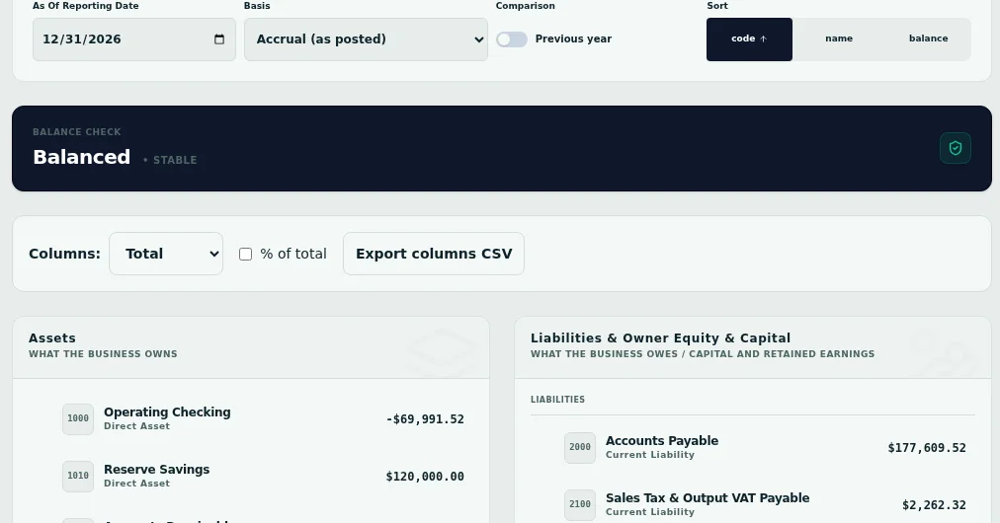

# Balance sheet · מאזן

## English

See what the business owns and owes, and the equity in it, as of one date. Earlier activity still counts.

1. Set the as-of date to the day you want to check.
2. Compare assets with liabilities plus equity. A balanced total alone does not prove that each entry is correct.
3. Inspect an account or open the entries behind a total to understand a balance.

## עברית

כאן רואים את הנכסים, ההתחייבויות וההון העצמי של העסק ליום מסוים. גם פעילות קודמת נכללת במאזן.

1. בחרו את התאריך שלגביו ברצונכם לבדוק את היתרות.
2. השוו בין הנכסים לבין ההתחייבויות בתוספת ההון העצמי. שוויון בין הסכומים אינו מוכיח שכל רישום נכון.
3. עיינו בחשבון או פתחו את פירוט התנועות שמאחורי סכום כדי להבין את היתרה.

*Sample books · ספרים לדוגמה*
