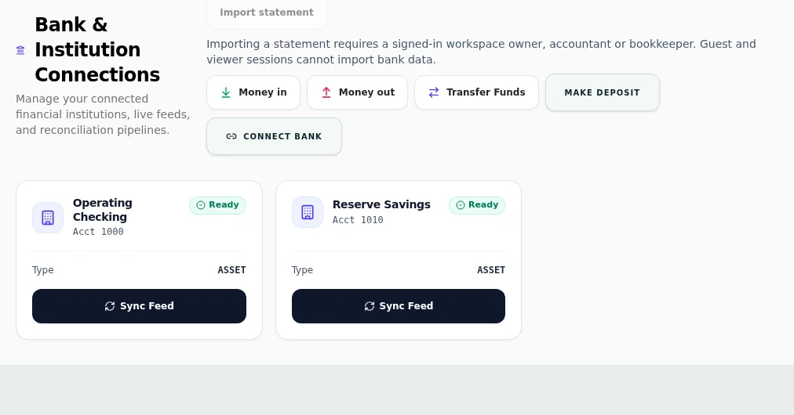

# Banking · בנקאות

## English

Review bank accounts and bring statement activity into the books for matching. A live feed requires a configured provider.

1. Check the bank account card before selecting a feed or recording a movement.
2. With a signed-in bookkeeping role, choose Import statement, select the account and review the file before confirming.
3. Review the import result, then open Reconcile to match the bank lines with existing entries. An import is not a match.

## עברית

כאן בודקים את חשבונות הבנק ומייבאים תנועות מדף הבנק לצורך התאמה. חיבור בנק פעיל מצריך ספק מוגדר.

1. בדקו את כרטיס החשבון לפני בחירת חיבור בנק או רישום תנועה.
2. לאחר כניסה בהרשאת עריכה מתאימה, בחרו בייבוא דף חשבון, בחרו חשבון ובדקו את הקובץ לפני האישור.
3. בדקו את תוצאת הייבוא ואז פתחו את מסך ההתאמות כדי לקשר שורות לתנועות קיימות בספרים. הייבוא עצמו אינו התאמה.

*Sample books · ספרים לדוגמה*
