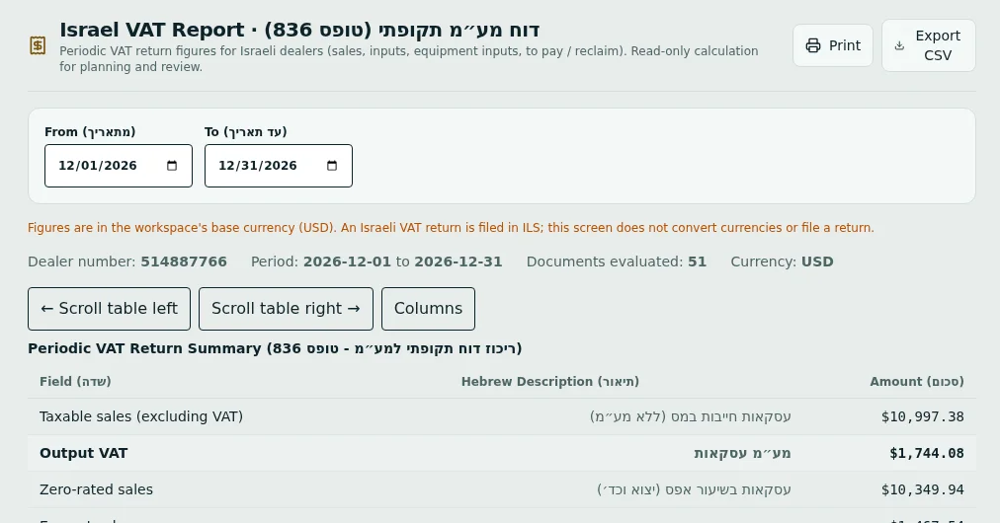

# Israel VAT report · דוח מע״מ בישראל

## English

Review periodic Israeli VAT figures calculated from the books. This worksheet does not convert currencies, file a return or pay tax.

1. Choose the dates and, if there is more than one registration, the VAT registration to review.
2. Compare output VAT with input VAT, including the separate equipment amount. A missing registration does not mean zero tax.
3. Check the workspace currency and data warnings before printing or exporting the figures for your accountant.

## עברית

כאן בודקים את נתוני המע״מ התקופתיים בישראל לפי הספרים. הגיליון אינו ממיר מטבעות, מגיש דוח לרשות המסים או משלם מס.

1. בחרו את התאריכים, ואם יש יותר מרישום אחד בחרו גם את תיק המע״מ לבדיקה.
2. השוו בין מס העסקאות למס התשומות ובדקו את הסכום הנפרד בגין ציוד. היעדר רישום אינו מעיד שסכום המס הוא אפס.
3. בדקו את מטבע הספרים ואת ההודעות על מצב הנתונים לפני הדפסה או ייצוא של הנתונים לרואה החשבון.

*Sample books · ספרים לדוגמה*
