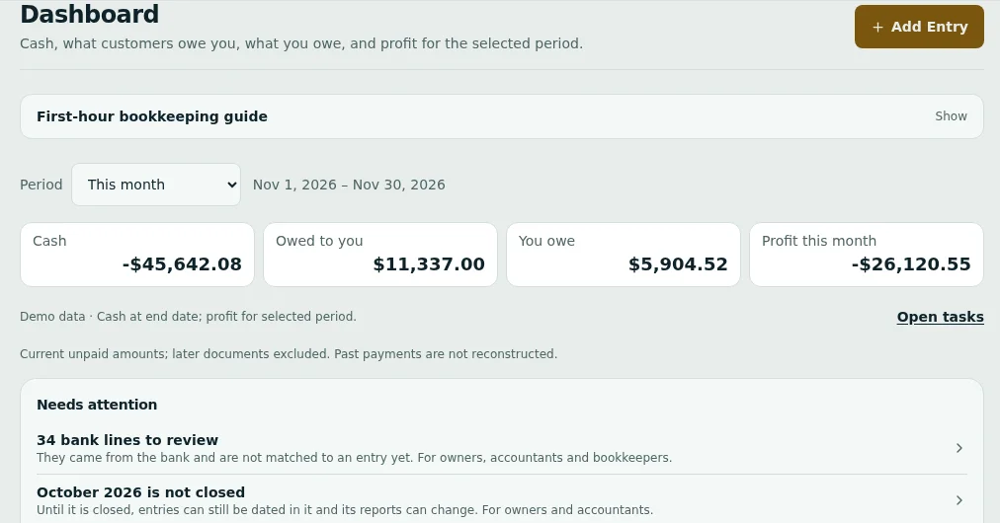

# Overview · סקירה כללית

## English

See how much cash the business has, what customers owe you, what you owe suppliers, and whether the business made a profit.

1. Choose a month, fiscal quarter, fiscal year or custom range.
2. Open a linked summary figure to see the report behind it. Cash is shown at the end date; profit covers the period.
3. Look under Needs attention for work to follow up, such as unmatched bank lines.

## עברית

כאן רואים כמה מזומן יש לעסק, כמה הלקוחות חייבים, כמה יש לשלם לספקים והאם העסק הרוויח.

1. בחרו חודש, רבעון כספי, שנת כספים או טווח תאריכים משלכם.
2. פתחו מדד שיש בו קישור כדי לעיין בדוח שמאחוריו. יתרת המזומן היא ליום הסיום; הרווח מתייחס לתקופה.
3. בדקו אילו משימות דורשות טיפול, למשל שורות בנק שעדיין לא הותאמו.

*Sample books · ספרים לדוגמה*

See also: **Accounting glossary** for definitions and **Help & Guide → First month & demo** for the setup checklist.

ראו גם: **מילון המונחים החשבונאיים** להגדרות ו**חודש ראשון והדגמה** במרכז העזרה לרשימת צעדי ההקמה.
