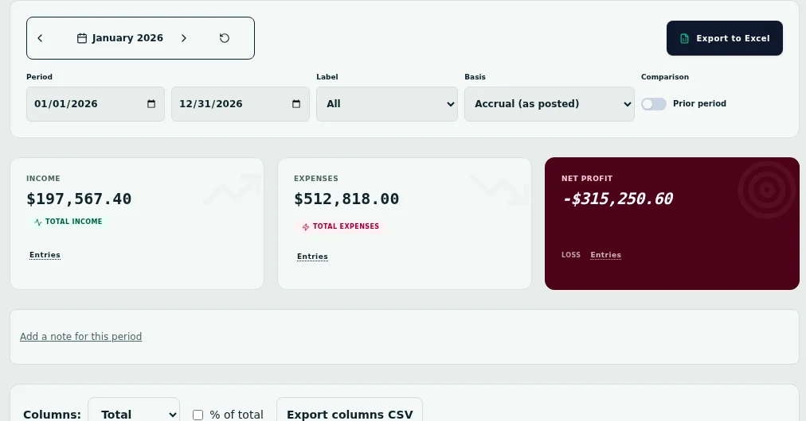

# Profit and loss · רווח והפסד

## English

Compare income and expenses to see whether the business made a profit over a period. Profit is not the bank balance.

1. Choose the start and end dates for the activity you want to review.
2. Check the accounting basis; use the comparison control when you need the previous period.
3. Open Entries under a total to see what contributed to it. Read the report’s data-status note before relying on the figure.

## עברית

משווים בין הכנסות להוצאות כדי לבדוק אם העסק הרוויח בתקופה שנבחרה. הרווח אינו יתרת הבנק.

1. בחרו תאריך התחלה ותאריך סיום לפעילות שברצונכם לבדוק.
2. בדקו את בסיס הדיווח. להשוואה לתקופה הקודמת הפעילו את אפשרות ההשוואה.
3. פתחו את פירוט התנועות מתחת לסכום כדי לראות ממה הוא מורכב. קראו את ההערה על מקור הנתונים לפני שמסתמכים עליו.

*Sample books · ספרים לדוגמה*
