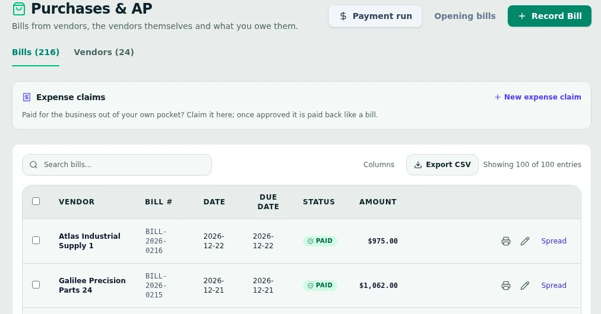

# Purchases and bills · רכש וחשבוניות ספק

## English

Use Purchases to keep supplier details, enter their bills and see what you owe.

1. On Vendors, find the supplier or add a new one.
2. Choose Record Bill and check the supplier, invoice number, dates and amounts against the original bill.
3. Review unpaid bills before starting a payment run. An open bill is not evidence that the supplier was paid.

## עברית

במסך הרכש מנהלים את פרטי הספקים, קולטים את החשבוניות שלהם ובודקים כמה העסק חייב.

1. בלשונית הספקים חפשו את הספק או הוסיפו ספק חדש.
2. בחרו ברישום חשבונית ספק ובדקו את הספק, מספר החשבונית, התאריכים והסכומים מול המקור.
3. עברו על החשבוניות הפתוחות לפני הכנת סבב תשלומים. חשבונית פתוחה אינה אישור שהספק קיבל תשלום.

*Sample books · ספרים לדוגמה*
