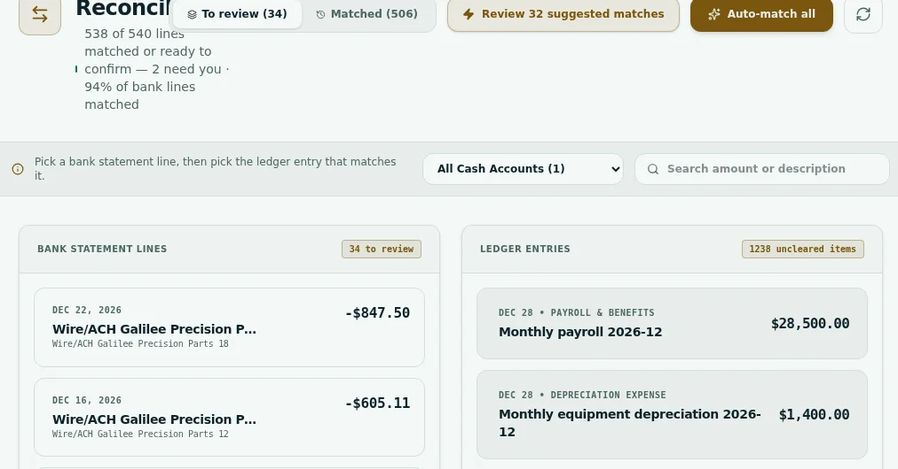

# Match bank lines · התאמת חשבון בנק

## English

Use Reconcile to link bank statement lines to entries already in your books. Matching a line does not close an accounting period.

1. Choose the cash account and open To review to find unmatched bank lines.
2. Select a bank line and the corresponding ledger entry. Check their amounts, dates and descriptions before confirming the match.
3. Open Matched to inspect earlier matches or undo a wrong match.

## עברית

במסך ההתאמות מקשרים בין שורות מדף הבנק לתנועות שכבר נרשמו בספרים. התאמת שורה אינה סגירת תקופה חשבונאית.

1. בחרו את החשבון ופתחו את רשימת השורות לבדיקה כדי למצוא שורות שטרם הותאמו.
2. בחרו שורה מדף הבנק ואת התנועה המתאימה בספרים. בדקו את הסכומים, התאריכים והתיאורים לפני אישור ההתאמה.
3. פתחו את רשימת השורות שהותאמו כדי לעיין בהתאמות קודמות או לבטל התאמה שגויה.

*Sample books · ספרים לדוגמה*
