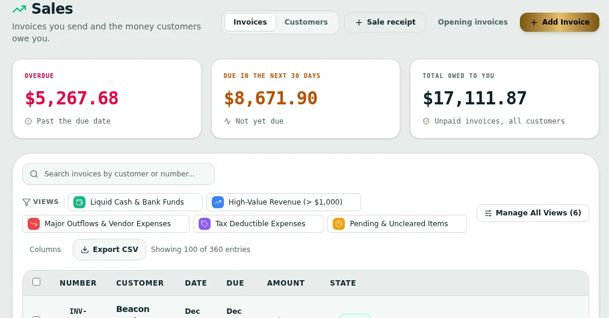

# Sales and invoices · מכירות וחשבוניות לקוח

## English

Use Sales to keep customer details, issue invoices and see which amounts are still unpaid.

1. On Customers, add the customer or look up their details.
2. On Invoices, choose Add Invoice. Check the customer, dates, lines and total before issuing it.
3. Open an unpaid invoice to record money the customer actually paid. Issuing an invoice is not receiving payment.

## עברית

במסך המכירות מנהלים את פרטי הלקוחות, מפיקים חשבוניות ובודקים אילו סכומים טרם שולמו.

1. בלשונית הלקוחות הוסיפו לקוח או חפשו את פרטיו.
2. בלשונית החשבוניות בחרו בהוספת חשבונית. בדקו את הלקוח, התאריכים, השורות והסכום לפני ההפקה.
3. פתחו חשבונית שטרם שולמה כדי לרשום תקבול שהתקבל בפועל. הפקת חשבונית אינה קבלת תשלום.

*Sample books · ספרים לדוגמה*
