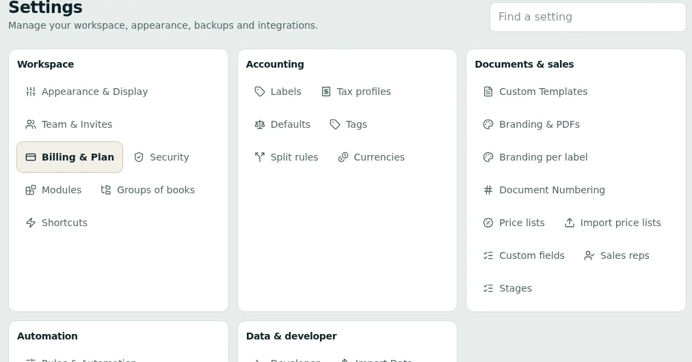

# Workspace settings · הגדרות סביבת העבודה

## English

Use Settings to find the options for these books. Your role determines which changes you can save.

1. Search for a setting or choose a section, such as Appearance & Display.
2. Open Team & Invites to review access to this workspace.
3. Use Backup & Export to download a backup before major changes. A file checksum is not proof that the backup is complete or can be restored.

## עברית

במסך ההגדרות מוצאים את האפשרויות לספרי העסק. ההרשאה שלכם קובעת אילו שינויים תוכלו לשמור.

1. חפשו הגדרה או בחרו מדור, למשל הגדרות תצוגה.
2. פתחו את מדור הצוות וההזמנות כדי לבדוק למי יש גישה לספרים האלה.
3. לפני שינויים גדולים הורידו גיבוי ממדור הגיבוי והייצוא. ערך ביקורת של קובץ אינו הוכחה שהגיבוי מלא או שניתן לשחזר אותו.

*Sample books · ספרים לדוגמה*
