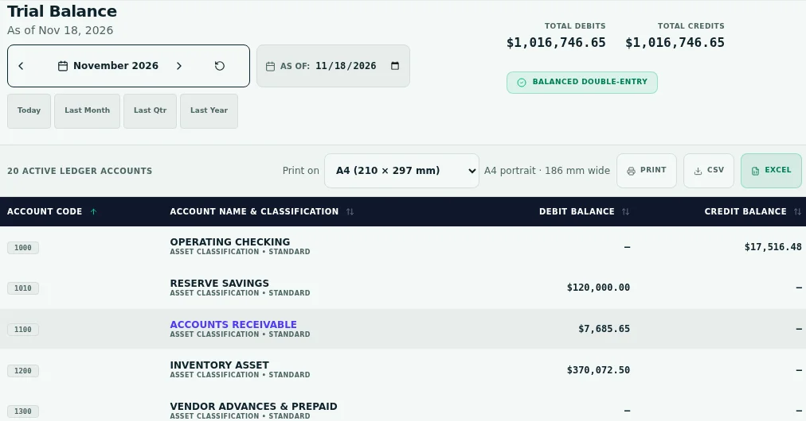

# Trial balance · מאזן בוחן

## English

In Ledger & Journal, the trial balance shows the debit and credit balances of accounts on a chosen day.

1. Choose Accountant Lens, then Trial Balance.
2. Set the as-of date and compare the debit and credit totals. Equal totals do not rule out missing or misclassified entries.
3. Select an account to inspect its entries, or print the trial balance for the date shown.

## עברית

באזור הספר הראשי והיומן, מאזן הבוחן מציג את יתרות החובה והזכות של החשבונות ליום שנבחר.

1. עברו לתצוגת רואה החשבון ואז בחרו במאזן בוחן.
2. בחרו תאריך והשוו בין סך החובה לסך הזכות. סכומים שווים אינם שוללים רישומים חסרים או סיווג שגוי.
3. בחרו חשבון כדי לעיין בתנועות שלו, או הדפיסו את מאזן הבוחן לתאריך המוצג.

*Sample books · ספרים לדוגמה*
